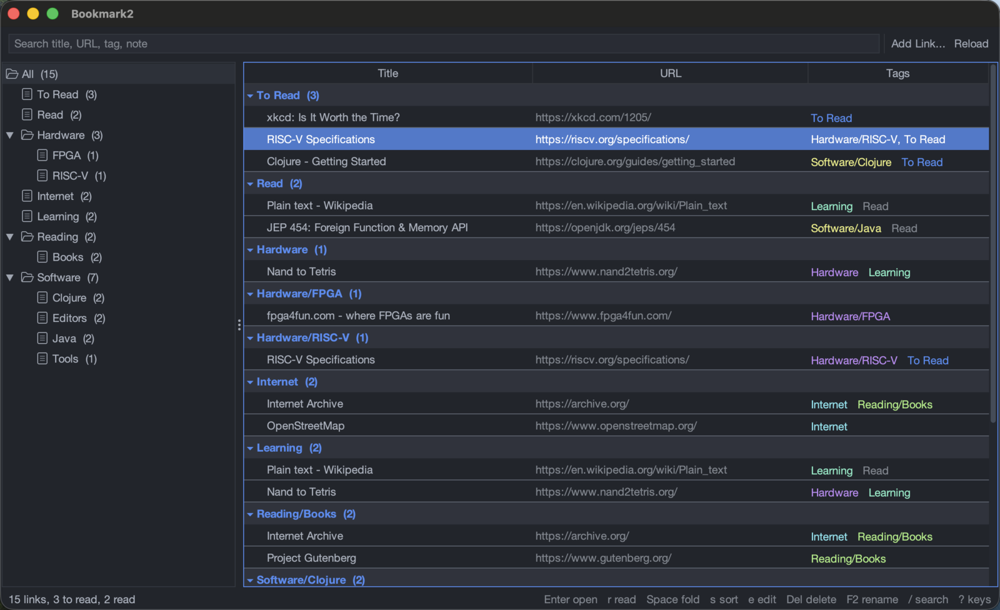

# bookmark2

Bookmarks and a reading list in one plain-text file, with a keyboard-first
desktop app and a command line.



Every link is a record in a single [GNU recutils](https://www.gnu.org/software/recutils/)
file. Tags organize it, and a `/` nests a tag into a tree (`Hardware/FPGA`).
Your reading list is two more tags, `To Read` and `Read`. Because the file is
plain text, `recsel`, `recfix`, `grep` and your editor all work on it, and it
diffs well in git.

```
%rec: Link
%key: Url

Url: https://www.nand2tetris.org/
Title: Nand to Tetris
Tag: Hardware
Tag: To Read
Note: build a computer from first principles
```

## Features

- **Tag tree** on the left, with counts. Choosing a branch shows every link in
  it and below it.
- **Links folded by tag** on the right, newest first. A link with two tags
  appears under both.
- **Search** across titles, URLs, tags and notes as you type.
- **Reading list**: `r` moves a link between To Read and Read.
- **Rename a tag** with F2. A `/` in the new name moves it, and everything
  below it, to another place in the tree.
- **Fully keyboard-driven**, with Vim-style keys (`j k g G`, `za zM zR` folds).
  `?` lists every key. The mouse is optional.
- **Undo** for every change. Writes are refused if another program changed
  the file since it was read.
- **37 dark themes**, including Gruvbox, Nord, Dracula, One Dark, Solarized and
  Monokai Pro, previewed live with Cmd+T.
- **Command line**: `bookmark2 add`, `list` and `read`, for scripts and
  terminals.

## Requirements

- A JDK, version 22 or newer. The app calls librec through the Java FFM API.
- The [Clojure CLI](https://clojure.org/guides/install_clojure).
- GNU recutils, which provides librec: `brew install recutils` or
  `apt install recutils`.

**Platforms:** developed and tested on macOS. Linux should work with the
distribution's `librec.so.1`, but it is untested. Windows is not supported,
because there is no packaged librec for it.

## Quick start

```bash
git clone https://github.com/raveensrk/bookmark2.git
cd bookmark2
bin/bookmark2 --data examples/data.rec      # try it on the sample links
```

The first run downloads Clojure, FlatLaf and its theme pack into `~/.m2`.

To use it every day, put the `bookmark2` command on your PATH and choose where
your links live:

```bash
script/install --data ~/notes/links.rec
bookmark2                                   # the window
bookmark2 add https://example.com -t Reading/Articles
bookmark2 read                              # what is tagged To Read
```

Without `--data`, the app uses `~/.local/share/bookmark2/data.rec`, and the
first add creates it.

On macOS, `script/build_app` builds a standalone `Bookmark2.app` that carries
its own Java runtime and installs it in `~/Applications`
(`script/install --app-dir DIR` changes the folder).

## Usage

`bookmark2 --help` prints the options, and `bookmark2 help` prints everything:
the file format, keys, folding, sorting, themes, configuration and exit codes.
In the window, press `?` for the key reference.

## Development

```bash
clojure -M:test                                         # tests (librec ones skip without it)
cp examples/data.rec try.rec                            # a scratch copy (gitignored)
bin/bookmark2 --repl 5555 --data try.rec                # socket REPL into the running window
```

[`AGENTS.md`](AGENTS.md) describes the code layout and the project rules.

## License

bookmark2 is free software, licensed under the
[GNU General Public License v3.0 or later](LICENSE).

It uses [FlatLaf](https://www.formdev.com/flatlaf/) and its IntelliJ theme pack
(Apache-2.0), [Clojure](https://clojure.org/) (EPL-1.0), and, at run time, GNU
librec from [recutils](https://www.gnu.org/software/recutils/) (GPL-3.0). librec
is loaded from your system and is not bundled.
